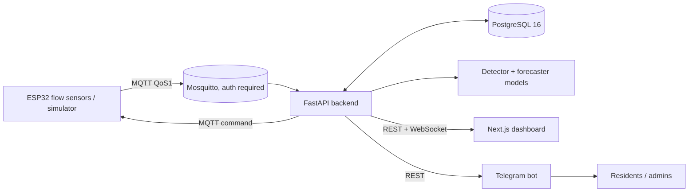

# AquaGuard

AI-assisted water-leak management for housing societies: edge ESP32 flow sensors publish over MQTT to a FastAPI backend that runs ML anomaly detection and a 4-tier alert state machine, surfaced in a Next.js dashboard and a Telegram bot.

## Why

India loses roughly 38% of supplied water as non-revenue water (NRW). In apartment complexes, the leaks that matter most are slow ones: a running cistern or a dripping joint can stay under any daily consumption cap for weeks, so threshold alarms never fire. AquaGuard looks at flow *patterns* (for example continuous night-time flow) rather than daily totals, and escalates through a controlled state machine instead of paging on every blip.

## Architecture



Alert tiers: `watch -> alert -> ticket -> critical` (see `docs/architecture.md`).

## Quickstart

Requirements: Docker with Compose v2, `make`, `openssl`.

```bash
make env                 # .env with fresh random secrets (never overwrites)
$EDITOR .env             # PUBLIC_DOMAIN, CADDY_TLS, MQTT_TLS_* (see docs/deployment.md)
make up                  # production stack: TLS proxy, backend, dashboard, Postgres, Mosquitto
make bootstrap-admin     # first admin; the password is prompted, never passed on a command line
```

Then open `https://$PUBLIC_DOMAIN`. For local development use `make dev-up` (plain HTTP on 127.0.0.1,
auto-reload); the sensor simulator (`make sim-up`) is a development/test tool and is never part of the
production stack. `make help` lists all targets; `docs/deployment.md` covers TLS, backups, monitoring
and upgrades, `docs/ci-cd.md` the pipelines.

## Layout

| Path | Contents |
|---|---|
| `backend/` | FastAPI app, Alembic migrations, tests |
| `dashboard/` | Next.js UI |
| `edge/` | ESP32 firmware and Python simulator (`python -m edge.simulator`) |
| `ml/` | Data generation, training scripts, `reports/`, `models/` (gitignored) |
| `bot/` | Telegram bot and tool registry |
| `infra/` | Mosquitto config, Postgres init, load test, helper scripts |
| `docs/` | Architecture, API, MQTT, security, deployment, CI/CD, limitations |

## Security model

| Role | Can do |
|---|---|
| resident | read data (any authenticated user) |
| maintenance | read + acknowledge / snooze / resolve alerts |
| admin | all of the above + valve control, overrides, role changes, retrain, forecast generation |

- Fail-closed secrets: with `ENVIRONMENT=production` the backend refuses to start without a `SECRET_KEY` of at least 32 characters; compose refuses to start without `SECRET_KEY`, the database passwords and `MQTT_PASSWORD`; the backend (production), the Mosquitto entrypoint, the bot and the database init script each reject `CHANGE_ME` placeholders for the secrets they consume, and `make check-env` checks them all (see the table at the top of `.env.example`).
- MQTT broker disallows anonymous clients; its password file is generated at start from env.
- Production publishes only 80/443 (Caddy, automatic HTTPS) and 8883 (MQTT over TLS); backend, dashboard, Postgres and the plain MQTT listener are reachable only on private networks. The development overlay publishes on 127.0.0.1 only.
- Rate limiting and WebSocket authentication are enforced by the backend; details in `docs/security.md`.
- Containers use `no-new-privileges`, read-only root filesystems where feasible, non-root users.

## Machine learning

The detector and forecaster are trained on **synthetic data** produced by `ml/scripts/generate_data.py`. Results on synthetic data say little about field performance. We do not quote metrics here; the actual numbers from the latest run are written by the training scripts to `ml/reports/*.md`. Run `make train` to regenerate them. No models have been validated on real hardware or real households.

## Testing

`make test` runs backend, ml, edge, dashboard and bot suites. CI (`.github/workflows/ci.yml`) additionally runs ruff, mypy (non-blocking), docker build smoke tests and secret/dependency scans. `make loadtest` runs a publisher-side MQTT load test (`infra/loadtest/`); it does not measure backend ingestion.

## Limitations

Synthetic-only ML, no hardware validation, single-node deployment, no token revocation. See `docs/limitations.md`.

## Roadmap

- Field pilot with real meters and labelled leak events
- Token revocation / refresh rotation
- Multi-node broker and database, backend ingestion benchmarks
- Per-user authorization in the bot against the backend instead of a shared service account
- Push notifications beyond Telegram

## License

MIT, see `LICENSE`. Security reports: `SECURITY.md`.
