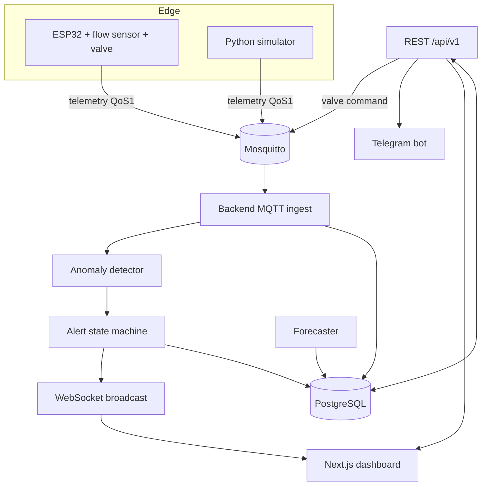

# Architecture

## Components
- **Edge**: measures flow/pressure, publishes JSON telemetry, subscribes to its command topic (valve open/close).
- **Mosquitto**: authenticated broker, persistence enabled, bound to localhost by default.
- **Backend**: ingests telemetry, scores it with the detector (models loaded from `MODEL_DIR`), drives the alert state machine, serves REST and a WebSocket feed, publishes valve commands.
- **Dashboard**: live view, alert handling, admin controls.
- **Bot**: Telegram front end using a backend service account and a role-checked tool registry.

## Alert state machine
`watch -> alert -> ticket -> critical`. Escalation needs sustained anomalous evidence; maintenance/admin may acknowledge, snooze or resolve at each stage; resolved alerts return to normal. Exact thresholds live in the backend code and are not duplicated here.

## Deployment
Single-node Docker Compose (see `docker-compose.yml`). Profiles: `demo` (simulator), `bot` (Telegram). Dev overrides in `docker-compose.override.yml`.
