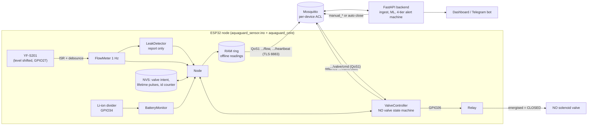
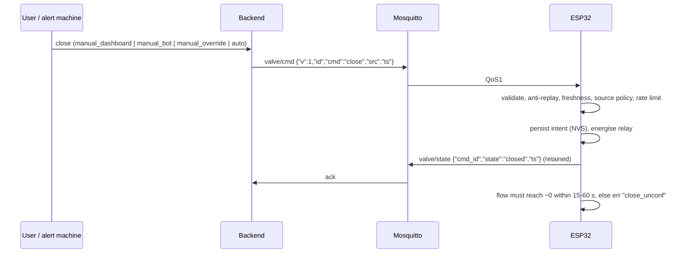

# AquaGuard hardware integration plan

Scope: ESP32 + YF-S201 flow sensor + normally-open (NO) solenoid shut-off valve + Li-ion battery
monitor, talking MQTT to the AquaGuard backend. **Everything here is UNTESTED on real hardware**
unless a line says otherwise. What *has* been exercised is listed in [Verification status](#verification-status).

| Document | Purpose |
|---|---|
| [wiring-and-electrical.md](wiring-and-electrical.md) | pin review, level shifting, divider, relay, protection, unknowns |
| [valve-safety.md](valve-safety.md) | NO-valve behaviour, what the firmware enforces, commissioning gate |
| [hil-test-plan.md](hil-test-plan.md) | staged bench -> water rig -> live tests, calibration jug procedure |
| [provisioning.md](provisioning.md) | device credentials |
| [mqtt-tls-setup.md](mqtt-tls-setup.md) | TLS (port 8883), CA, clock |
| [troubleshooting.md](troubleshooting.md) | symptom -> cause |
| [platform-notes.md](platform-notes.md) | "Wokio" / Wokwi findings |
| [limitations.md](limitations.md) | what this does not do |
| [ci-snippet.yml](ci-snippet.yml) | proposed CI jobs (not wired into `.github/`) |

## Delivery order (smallest safe path)

1. **Telemetry only.** Flash with the valve relay *unconnected*. Check `flow`, `vol`, `tot`, `bat`,
   `rssi` in the dashboard against a measuring jug (calibrate `PULSES_PER_LITRE`).
2. **Alerts.** Local detector flags (`err`: `burst`, `leak_cont`, `leak_night`, ...) are *reported*;
   the backend's own ML/state machine remains the decision maker. Local shut-off stays OFF.
3. **Valve control, manual only.** Valve on a test rig, then live with `ACCEPT_AUTO_CLOSE 0`
   (default): only humans (`manual_*`) can actuate. Auto shut-off only after
   [hil-test-plan.md](hil-test-plan.md) Stage 3 sign-off *and* a backend gate (see follow-ups).

## Architecture and data flow



Sequence for a close command:



## Payload contract

Topics and the `flow` / `heartbeat` / `valve/cmd` / `valve/state` shapes are unchanged
(see [../mqtt.md](../mqtt.md)). The `flow` payload keeps the nine existing fields **in the same
order** and appends optional ones that `backend/app/schemas/mqtt.py::FlowPayload` already validates:

```json
{"v":1,"id":"a1b2c3d4","ts":1760000000,"flow":0.4,"vol":12.3,"psi":null,"tmp":null,"bat":87,"rssi":-61,
 "tot":98765.4,"vbat":4.01,"valve":"open","fw":"2.0.0-dev","err":["leak_cont"]}
```

| Field | Meaning in firmware |
|---|---|
| `flow` | mean L/min over the reporting period (pulses / `PULSES_PER_LITRE`) |
| `vol` | litres since **boot** (backend bound is 100 000; lifetime would exceed it). Resets on reboot like the simulator |
| `tot` | lifetime litres, persisted to NVS (<= 1 L / 5 min wear policy; can lose up to that on power cut) |
| `bat` / `vbat` | percent from an **approximate** Li-ion table / volts; `null`/absent when no battery or ADC fault |
| `valve` | the **commanded** state. There is no position feedback (see valve-safety.md) |
| `err` | up to 8 codes, priority order: `burst leak_cont leak_night close_unconf flow_impossible stuck_line adc_fault bat_crit bat_low coil_duty backfill_drop ts_est store_fail rst_brownout rst_wdt` |
| `psi`, `tmp` | always `null`: sensor model/wiring unspecified, no driver exists ([optional_sensors.h](../../edge/firmware/aquaguard_sensor/optional_sensors.h) is an interface stub) |

`id` = 32-bit bijection of a counter whose high-water mark is persisted in blocks of 4096, so ids do
not repeat across reboots (a fresh/erased NVS starts at a random counter instead; low collision
probability, not zero). A replayed buffered reading keeps its `id`, so the backend's
`(flat, message_id)` de-duplication absorbs QoS 1 duplicates.

`MAX_BACKFILL_S` defaults to **540 s**: `Settings.mqtt_max_reading_age_s` is 600 s, so older live
readings are rejected. Longer outages lose readings (flagged `backfill_drop` on the next one;
`tot` still carries the volume). LWT is **not** implemented: the device ACL
(`infra/mosquitto/acl.device.template`) only allows writes to `flow`, `heartbeat`, `valve/state`;
the backend already marks sensors late/offline after 2/5 min without data. Proposal if wanted: add a
`.../status` topic to the ACL and contract.

## Source layout

```
edge/firmware/aquaguard_sensor/
  aquaguard_core.{h,cpp}   portable logic, no Arduino deps (host-tested)
  aquaguard_sensor.ino     hardware glue: ISR, relay, NVS, Wi-Fi, SNTP, MQTT/TLS, watchdog
  optional_sensors.h       psi/tmp interface stub (no drivers)
  config.h.example         copy to config.h (git-ignored)
edge/firmware/test/        test_core.cpp (unit), emit_payloads.cpp (scenario payloads)
edge/firmware/Makefile     `make -C edge/firmware test`
edge/tests/test_firmware_payload.py   payloads vs backend schema + simulator parity (+ Mosquitto)
```

## Verification status

| Item | Status |
|---|---|
| Core logic, 46 host unit tests (ASan/UBSan, `-Werror`) | passes (`make -C edge/firmware test`) |
| Payloads vs real `FlowPayload`/`HeartbeatPayload`/`ValveAckPayload`, simulator parity | passes (`edge/tests/test_firmware_payload.py`) |
| Simulator against a private Mosquitto (port picked at random, anonymous) | passes, same schema |
| Sketch **compiles** (arduino-cli 1.1.1, `esp32:esp32` core 3.0.7, FQBN `esp32:esp32:esp32`, espMqttClient 1.7.3 from upstream `main`, ArduinoJson 7.2.1, AsyncTCP) | yes, with the example `config.h`: 1 059 949 B flash (80 %), 52 272 B RAM (15 %). Compile only |
| Sketch flashed / run on an ESP32, any real sensor, relay, valve, TLS handshake, NVS wear | **NOT DONE** |

## Inputs the integrator must supply (none are known)

* Valve datasheet: coil voltage (DC/AC), inrush and holding current, duty rating (continuous-duty?), pipe size, pressure range, closing time.
* Relay board model: active level, input current, logic voltage, contact ratings for the *inductive DC/AC* load.
* Power budget and supplies: valve supply, 5 V rail, battery capacity/charger, whether mains presence is detectable.
* YF-S201 exact variant: supply voltage used, signal level and whether the board has a pull-up.
* Broker CA PEM, per-device username/password (see [provisioning.md](provisioning.md)), Wi-Fi SSID.
* `TZ_OFFSET_S` for the site (night window), calibration result (`PULSES_PER_LITRE`), real battery divider ratio.

## Backend follow-ups (owned by others)

1. Persist `tot`, `vbat`, `valve`, `err`, `fw` from `FlowPayload` (currently accepted and dropped per the schema comment); alert on `err` codes.
2. Decide on the stale window (`mqtt_max_reading_age_s`); consider a bounded device-replay allowance if outages > 10 min matter.
3. Commissioning gate: refuse `src:"auto"` close for a flat until its hardware validation is recorded (a flag per flat); the firmware also refuses auto close unless built with `ACCEPT_AUTO_CLOSE 1`.
4. Valve-ack handling: an ack with a *different* state than commanded must not confirm the command (it already compares), and `err: close_unconf` should escalate to a human.
5. Optionally accept the `cmd_id:"boot"` state report (`PUBLISH_BOOT_VALVE_STATE`) and `valve/state` reconciliation after reboot.
6. Reconcile device username format: CLI prints `<society>.<unit>`, broker/simulator use `<society>/<unit>` ([provisioning.md](provisioning.md)).
7. Sync `docs/mqtt.md` with the optional fields above.
